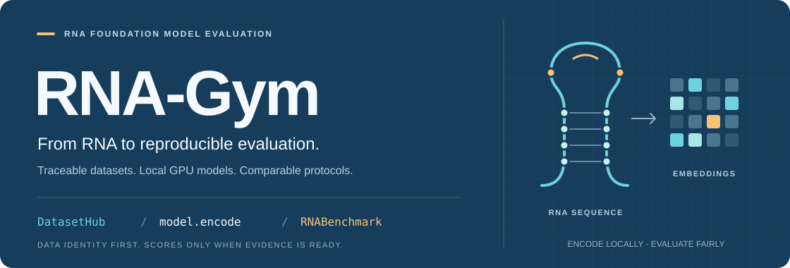

# RNA-Gym

<p align="center">
  
</p>

<p align="center">
  <strong>One Python interface. Traceable data. Honest model comparisons.</strong><br>
  面向 RNA 基础模型的原生评测接口：从真实数据与标签，到可复现的能力比较。
</p>

<p align="center">
  <a href="#quick-start"><strong>Quick start</strong></a> ·
  <a href="docs/NATIVE_SDK.md">Python API</a> ·
  <a href="docs/DATASET_TASK_LABEL_AUDIT.md">Data &amp; labels</a> ·
  <a href="#capabilities">Capabilities</a> ·
  <a href="#workstreams">Task workstreams / 任务分块</a> ·
  <a href="#中文">中文</a> · <a href="#english">English</a> ·
  <a href="https://mondragondeiontonio-sketch.github.io/RNA-GYM/">Website</a>
</p>

<p align="center">
  <a href="https://github.com/mondragondeiontonio-sketch/RNA-GYM/actions/workflows/pages.yml">
    
  </a>
  
  
  
</p>

> [!IMPORTANT]
> **Research infrastructure, not an admitted benchmark release.** Updated
> **2026-10-27**: the native SDK and real RNA-FM GPU encoding are verified;
> **0 admitted tasks** and **no reviewed real-assay model scores** are available.
> Data acquisition, label evidence, scientific admission and ranking eligibility
> are separate milestones. 本地已有数据与标签；科学 HOLD 不等于“没有数据”。
>
> The SDK is currently on `native-sdk-python-api-20261027`
> ([PR #4](https://github.com/mondragondeiontonio-sketch/RNA-GYM/pull/4)),
> not yet merged into `main`. The website is a separately deployed audit preview.

## At a glance · 项目概览

| What | Verified scope | What it does **not** mean |
|---|---|---|
| Registry | **198 task rows · 123 source families · 47 acquisition groups** | These are not counts of independently verified assays. |
| Local source snapshot | **50 file versions · 16 package groups** | Raw files are not shipped with this repository. |
| Target evidence | **26 files/archives** with targets or reference structures | An observed target is not necessarily an admitted experimental label. |
| Native encoder | **RNA-FM**, real CUDA encoding from source and an installed wheel | Other registered models are not silently substituted. |
| Evaluation & ranking | Fixed-budget readouts and compatible-panel ranking contracts | No fabricated scores, missing-as-zero entries or unofficial main leaderboard. |

Explore the [Dataset Atlas][atlas], [QC Dashboard][qc] and
[task/label audit][label-audit]. Local-file figures describe the publisher's
snapshot, not data automatically available on a fresh clone.

<a id="workstreams"></a>

## Task workstreams · 按任务分块推进

我们按生物学输入与输出拆分工作，而不是同时启动198条任务。
下面的分块**只用于工作分配**，不新增实验、不改变旧T/X任务ID，也不合并不同测量或排行榜。
Every registered row belongs to exactly one workstream; these are not independent
assay counts or a claim that every dataset is ready to train.

<!-- WORKSTREAMS:START -->

| Workstream / 工作块 | Registered rows / 注册行 | Admitted / 准入 |
|---|---:|---:|
| 序列与调控 / Sequence & regulation | 68 | 0 |
| 二级结构 / Secondary structure | 13 | 0 |
| 三级结构 / Tertiary structure | 16 | 0 |
| 突变效应 / Variant effects | 9 | 0 |
| 逐核苷酸读出 / Nucleotide probing | 10 | 0 |
| RNA–RNA 相互作用 / RNA pairs | 6 | 0 |
| RNA–配体 / RNA–ligand | 15 | 0 |
| 逆折叠与设计 / Inverse folding & design | 34 | 0 |
| 原始信号 / Direct-RNA signals | 4 | 0 |
| 方法与待解析项 / Methods & unresolved | 23 | 0 |
| **Total / 合计** | **198** | **0** |

<!-- WORKSTREAMS:END -->

- **序列与调控 / Sequence:** first close one assay's source, units, conditions and
  split; keep MRL, TE, RSS, half-life and annotation targets distinct.
- **二级结构 / 2D:** verify paired/unpaired versus pair-edge labels, residue/token
  maps, masks and decoder. Chemical probing is a separate task, not pair truth.
- **三级结构 / 3D:** verify assembly/model/chain, missing residues, geometry and
  sequence/structure homology before model evaluation.
- **突变 / Variants:** verify RNA substrate, WT/variant round-trip, readout
  orientation and RNAGym/NABench experimental reuse; no cosine-as-fitness shortcut.
- **Other workstreams:** paired RNA, ligands, design and raw signal keep their
  own identities, labels and evaluation contracts; scalar heads do not cover them.

[完整工作块说明](docs/TASK_WORKSTREAMS.md) ·
[机器可读任务分块索引](data/registries/task_workstream_index.json)

```bash
# No downloads, model loading or training.
python tools/build_workstream_index.py --verify
python tools/build_workstream_index.py --task T0021
```

**Current continuation:** W00 hash/version reconciliation is complete. W01 is
still blocked by original-assay/rights/reviewer evidence. W02 now addresses file
version identity and work allocation; unresolved assay fields remain unknown.
The independent review still flags ranking-result identity/label-budget checks,
native execution budgets and bootstrap instability reporting. **This is not a
formal benchmark release or a declaration that those blockers are fixed.**

<a id="quick-start"></a>

## Quick start · 快速开始

### 1. Explore datasets — no GPU, weights or API key required

Use **Python 3.10+**. Catalog inspection from the checkout needs only the standard
library; it does not download data or contact a model service.

```bash
git clone --branch native-sdk-python-api-20261027 https://github.com/mondragondeiontonio-sketch/RNA-GYM.git
cd RNA-GYM
```

```python
from rna_gym import DatasetHub, RNAHub

hub = DatasetHub()
print(len(hub.list()))                  # 198 original task IDs
print(hub.get("T0021").describe())       # MRL task, label evidence and HOLD reasons
print(RNAHub.list())                    # Registered models != implemented adapters
```

For editable installation in an existing environment with `setuptools>=61` and
`wheel`, use `python -m pip install --no-deps --no-build-isolation -e .`.
A wheel contains code, not the registries or private assets: set `RNA_GYM_ROOT`
or pass `root=` to the checkout when using a non-editable installation.

### 2. Encode RNA — bring a verified local checkpoint and CUDA runtime

This step requires a reviewed, hash-pinned RNA-FM source/checkpoint/model-card
manifest and a compatible local GPU environment. The manifest below is a
**user-provided file**, not a bundled example or an automatic download.
See the [native SDK setup][sdk] for requirements.

```python
from rna_gym import RNAHub, RNABenchmark

model = RNAHub.load(
    "RNA-FM",
    manifest="runs/local/rnafm_manifest.json",
    device="cuda:0",
)
embeddings = model.encode(
    sequences=["AUGCUACGUACG", "GGCAUUACGU"],
    layer="last",
    pooling="masked_mean",
)
print(embeddings.shape)                 # (2, 640)

runner = RNABenchmark(
    dataset="mrl_sugimoto",
    protocol="frozen_mlp",
    split="official",
    seed=42,
    output="runs/pilots/mrl",
)
results = runner.evaluate(model)
print(results.status)                  # BLOCKED until this assay is admitted
```

- Every FM forward runs on **CUDA**; there is no CPU fallback or model download.
- Exact `A/C/G/U` input only: no silent T→U conversion, normalization or truncation.
- Relative manifest and run-output paths resolve against the checkout, not the
  current shell directory. Evaluation artifacts stay inside ignored `runs/`.
- `split="official"` requests a reviewed binding; it does not invent an official
  split. `seed=42` is exploratory, not the formal five-seed matrix.
- `BLOCKED`, `FAILED`, `NOT_APPLICABLE` and partial execution remain distinct.
  A model forward passing is not a real functional-assay score.

<a id="capabilities"></a>

## What works today · 能力状态

| Component | Implemented / verified | Remaining boundary |
|---|---|---|
| `DatasetHub` | 198-task catalog, types, target evidence, bounded local preview | Local bytes and assay-level identity/rights must be supplied and reviewed. |
| `RNAHub.load` / `encode` | RNA-FM on CUDA; last-layer masked mean or per-nucleotide arrays | Other five registered backends are not yet native-verified. |
| `RNABenchmark.evaluate` | Existing admission gate, frozen scalar heads, predictions/metrics/statistics artifact path | No assay currently passes all scientific gates. |
| Fixed-label readouts | Ridge, binary linear/logistic and MLP; train-only preprocessing, budget ≤64 | Numerical contract tests are synthetic software tests, not biological results. |
| `RNALeaderboard` | Dataset panels and source-aware capability aggregation contracts | Real admitted predictions, a complete fixed panel and independent review required. |
| Optional HTTP console | Existing local transport layer | Not the primary API; no OpenAI dependency or API key needed for the SDK. |

### Evaluation tracks

| Track | Current implementation boundary |
|---|---|
| **Zero-shot likelihood** | Registered protocol; no native functional likelihood pilot. |
| **Frozen + Ridge** | Real RNA-FM encoder verified; fixed scalar readout tested. |
| **Frozen + MLP** | Real RNA-FM encoder verified; fixed scalar readout tested, no admitted assay fit. |
| **LoRA** | Separate adapter, protocol and execution budget still required. |
| **Full fine-tuning** | Separate implementation and execution budget still required. |
| **Random initialization** | Encoder initialization is an explicit factor; no real task comparison claimed. |

Multilabel, token, pair, structure, ligand-conditioned and generation tasks need
modality-specific heads and protocols. They are **not** converted into scalar MLP
problems. See the [evaluation protocol][evaluation] and
[model registry][model-registry].

## Two views of model quality · 两种排名，不拼凑总分

| View | Comparable unit | Fairness rule |
|---|---|---|
| **By dataset** | Same assay/endpoint, split, input context, protocol, initialization, label budget and seed panel | No best-head selection, dropped failures or post-hoc common subset. |
| **By capability** | Same capability and primary metric, with reviewed assay/source mapping | Average assays within a source cluster, then weight source clusters equally. |

Signed Spearman stays signed. Average precision (AP) uses the threshold-step
precision–recall definition in the [evaluation protocol][evaluation], not
trapezoidal PR-AUC. Spearman, AP, pair-F1 and geometry metrics are not mixed into
an arbitrary global score. Missing or blocked cells remain `None`, never zero.
The ranking API example and panel requirements are in the [SDK guide][sdk].

## Data & labels · 数据与标签

Our catalog integrates existing sources without claiming ownership of their data:

| Domain | Representative registered sources | Keep separate |
|---|---|---|
| mRNA regulation & fate | mRNABench, EukaUTR | MRL, TE, half-life, localization and variant effects. |
| Binding & interactions | miRBench, ENCODE eCLIP, RNA-Scope, RNAmigos2 | Paired RNA, protein/site and ligand-conditioned tasks. |
| Variant & nucleotide measurements | RNAGym DMS, NABench, RMDB, Ribonanza | WT/variant context, native fitness and token-level readouts. |
| Structure & design | RNA3DB, bpRNA, RNAStrAlign, RNAInvBench | 2D pairs, 3D coordinates and conditional generation. |

These are source-level registrations, not a claim that every benchmark is
fully downloaded, labeled, licensed or admitted. Annotation targets, proxy labels,
experimental measurements and model-result tables are not interchangeable.
The [complete label audit][label-audit] explains all original task types, observed
targets and unresolved input/split issues.

**A concrete gate, not a vague disclaimer:** the T0021 audit found 382 shared
exact-input keys across folds in a local author-logic reconstruction. This is
**not an official** fixed-split conclusion or **full RNA homology clearance**.
A separately named exploratory grouped split removes the checked overlaps, but
**original-assay/condition HOLD** remains. See the [MRL split audit][mrl-audit].

<a id="中文"></a>

## 中文

### 我们的 idea 与愿景

RNA-Gym 连接 **可溯源数据 → 可靠任务 → 公平评测 → 生物学理解 → 模型创新**。
我们不只拼接现有榜单，而是先弄清每个标签测量了什么、来自哪个 assay、在什么条件下
成立，再比较预训练知识、适配方法、标签量和计算预算的贡献。

科学问题包括：预训练相对随机初始化学到了什么；冻结表征与适配方法如何比较；
需要多少标签；能否跨 gene/family/cell/assay 迁移；以及单序列以外的条件是否真正
改善预测。结构 native 输出与标签校准输出分轨，不把不同信息预算混为一种能力。

近期目标是完成首个真实 assay 的完整链路，再扩展到首批 5–10 个代表任务；实际数量
以准入证据为准，不为凑数删除任务、减少种子或跳过 gate。长期希望用可信评测识别
能力缺口，支持针对性预训练、新模型和独立实验验证。这是研究路线，不是已完成结论。

<a id="english"></a>

## English

### Our idea and vision

RNA-Gym connects **traceable data → reliable tasks → fair evaluation → biological
understanding → model innovation**. The goal is not another merged score table:
we distinguish what was measured, in which assay and context, before attributing
improvement to pretraining, adaptation, label count or compute.

### Scientific questions

1. What does pretraining contribute beyond matched random initialization?
2. Which frozen or trainable adaptation strategy is effective at the same budget?
3. How many labels are needed, including labels spent on tuning and calibration?
4. Does performance transfer across genes, families, cells and assays?
5. When do paired inputs, structure, ligands or tools add genuine predictive value?

The near-term milestone is one real, admitted end-to-end assay, followed by a
representative panel only where evidence supports it. Longer-term model and
experimental work are research goals, not completed findings. Preserve upstream
splits when defensible, version custom splits, require asset-specific
rights review and never replace human admission approval with an automated signature.

## Verify locally · 本地验证

```bash
python -m unittest discover -s tests -v
python tools/generate_site.py --verify
python tools/build_task_bundles.py --verify
python tools/rnagym.py plan
python tools/evaluation_protocol.py smoke --dry-run
python -m http.server 8000 --directory site
```

These commands do not download data or launch FM training. Optional numeric,
browser and private-evidence tests explicitly skip when requirements are absent;
skips are not scientific passes. Full local QC dependencies are documented in
[requirements-qc.txt](requirements-qc.txt). Acquisition is a separate explicit,
budgeted action described in the [public protocol][public-protocol].

## Project map · 项目结构

```text
RNA-GYM/
├── rna_gym/              # Native model, dataset, benchmark and ranking API
├── configs/              # Existing model, protocol and execution contracts
├── data/registries/       # Public task/source/package catalog, not raw data
├── data/task_bundles/     # All original task cards
├── tools/                 # Acquisition, provenance, QC and execution
├── tests/                 # Safety, numerical and documentation contracts
├── docs/                  # Methods, API and audit status
└── site/                  # Public atlas, QC dashboard and audit preview
```

<a id="source-package-index"></a>

## Source package index · 全部资源包

<details>
<summary><strong>展开 / Expand: 47 registered acquisition groups</strong></summary>

These are management groups, not independent original assays. Task-row counts
come directly from the frozen package registry and include controls and
methodology-only entries. Listing is not an availability or admission claim.

下表直接对应资源包注册表，包含 control / methodology 条目。
同一原始实验可能跨来源复用；不可据此累加独立实验数或样本数。

| Package ID | Source / 来源 | Registered rows / 注册行 |
|---|---|---:|
| `APTAMER_DB` | Ribocentre aptamer experimental records | 2 |
| `BEACON_ALL` | BEACON 13 downstream datasets | 13 |
| `CASP` | CASP Nucleic Acid blind structures | 2 |
| `DORADO_MOD` | Nanopore Dorado modification benchmarks | 2 |
| `ENCODE_ECLIP` | ENCODE CLIP original experiment accessions | 23 |
| `EUKAUTR` | EukaUTR nine UTR task families | 12 |
| `GRNADE` | gRNAde geometric inverse design | 3 |
| `METHODOLOGY_ONLY` | Methodology or tools (no independent assay) | 4 |
| `MIR_BENCH` | miRBench corrected AGO2 CLASH/eCLIP | 2 |
| `MRNA_ECLIP` | mRNABench HF: eclip | 1 |
| `MRNA_GO_MF` | mRNABench HF: go-mf | 1 |
| `MRNA_MIRNA_TARGET` | mRNABench HF: mirna-target | 1 |
| `MRNA_MRL_HL_LBKWK` | mRNABench HF: mrl-hl-lbkwk | 1 |
| `MRNA_MRL_SAMPLE` | mRNABench HF: mrl-sample | 1 |
| `MRNA_MRL_SUGIMOTO` | mRNABench HF: mrl-sugimoto | 1 |
| `MRNA_PROTEIN_LOCALIZATION` | mRNABench HF: protein-localization | 1 |
| `MRNA_RNAHL_SALUKI_HUMAN` | mRNABench HF: rnahl-saluki-human | 1 |
| `MRNA_RNAHL_SALUKI_MOUSE` | mRNABench HF: rnahl-saluki-mouse | 1 |
| `MRNA_RNA_LIFECYCLE_IETSWAART` | mRNABench HF: rna-lifecycle-ietswaart | 1 |
| `MRNA_RNA_LOC_FAZAL` | mRNABench HF: rna-loc-fazal | 1 |
| `MRNA_TRANSLATION_EFFICIENCY_HUMAN` | mRNABench HF: translation-efficiency-human | 1 |
| `MRNA_TRANSLATION_EFFICIENCY_MOUSE` | mRNABench HF: translation-efficiency-mouse | 1 |
| `MRNA_UNRESOLVED_RNA_LOC_LR` | mRNABench RNA-Loc-LR (identity unresolved) | 1 |
| `MRNA_UTR_VARIANTS_BOHN` | mRNABench HF: utr-variants-bohn | 1 |
| `MRNA_VEP_TRAITGYM_MRNA` | mRNABench HF: vep-traitgym-mrna | 1 |
| `NABENCH_DMS` | NABench released DMS individual assay files | 10 |
| `NABENCH_SELEX` | NABench SELEX (processing pending) | 2 |
| `NANOLYMPICS` | NanOlympicsMod direct RNA sequencing | 2 |
| `NC_BENCH` | NC-Bench noncanonical pair edges+orientations | 2 |
| `OPENVACCINE` | OpenVaccine degradation challenge | 3 |
| `PARNET` | PARNET supervised pretraining (not full released dataset) | 4 |
| `RDESIGN` | RDesign tertiary inverse folding | 2 |
| `RIBONANZA_ORIGINAL` | Ribonanza challenge original reference files | 2 |
| `RNA3DB` | RNA3DB release with structure-homology split | 3 |
| `RNABENCH_SOFTWARE` | RnaBench algorithm library | 2 |
| `RNAGYM_3D` | RNAGym 3D PDB structure benchmark | 1 |
| `RNAGYM_DMS` | RNAGym DMS assay processed+raw | 3 |
| `RNAGYM_RMDB` | RNAGym RMDB / Ribonanza probing | 6 |
| `RNAMIGOS2` | RNAmigos2 ligand pockets / docking / ROBIN | 4 |
| `RNA_INV_BENCH` | RNAInvBench inverse design public sets | 26 |
| `RNA_PUZZLE_TOOL` | RNA-Puzzles structure evaluation toolkit | 2 |
| `RNA_SCOPE` | RNA-Scope multi-task benchmark files | 13 |
| `ROMET` | ROMET-RNA structure benchmark | 2 |
| `R_BIND` | R-BIND 2.0 curated RNA-ligand database | 2 |
| `SECONDARY_LITERATURE` | RNA structure/interaction method-specific derived data | 21 |
| `SMRTNET` | SMRTnet processed ligand pairs | 2 |
| `WANG_ZERO_SHOT` | Wang zero-shot 2D/homology study supplement | 5 |

</details>

## Contribute · 参与建设

Contribute a bounded source review, label/assay mapping, reproducible QC or a real
model adapter through [GitHub Issues][issues]. Include pinned versions, hashes,
measurement semantics and tests. Keep unknowns explicit; do not guess a DOI,
license, accession or sample count. See the [current audit status][audit-status].

请勿提交原始实验数据、模型权重、凭据、私有样本映射或人工审批文件。
Scientific gates and the formal seed panel `[11, 23, 47, 71, 101]` must remain
unchanged. Do not tune a formal protocol on test performance.

## License & attribution · 许可与引用

See [LICENSE_NOTICE.md](LICENSE_NOTICE.md). This repository does **not** grant a
blanket license to upstream datasets or checkpoints. Public availability is not
permission to redistribute. Cite the actual upstream publications, fixed data
versions and exact repository commit used. No project paper or DOI is claimed.

RNA-Gym is independent. References to RNAGym, NABench, BEACON, mRNABench and other
sources do not imply affiliation or endorsement. The repository distributes
code, indexes and approved aggregate metadata—not the local experimental collection.

[atlas]: https://mondragondeiontonio-sketch.github.io/RNA-GYM/phase2.html#atlas
[audit-status]: docs/CURRENT_AUDIT_STATUS.md
[evaluation]: docs/EVALUATION_PROTOCOL.md
[issues]: https://github.com/mondragondeiontonio-sketch/RNA-GYM/issues
[label-audit]: docs/DATASET_TASK_LABEL_AUDIT.md
[model-registry]: configs/model_adapter_registry.yaml
[mrl-audit]: https://mondragondeiontonio-sketch.github.io/RNA-GYM/mrl-split-audit.html
[public-protocol]: docs/PUBLIC_PROTOCOL.md
[qc]: https://mondragondeiontonio-sketch.github.io/RNA-GYM/phase2.html#qc
[sdk]: docs/NATIVE_SDK.md
